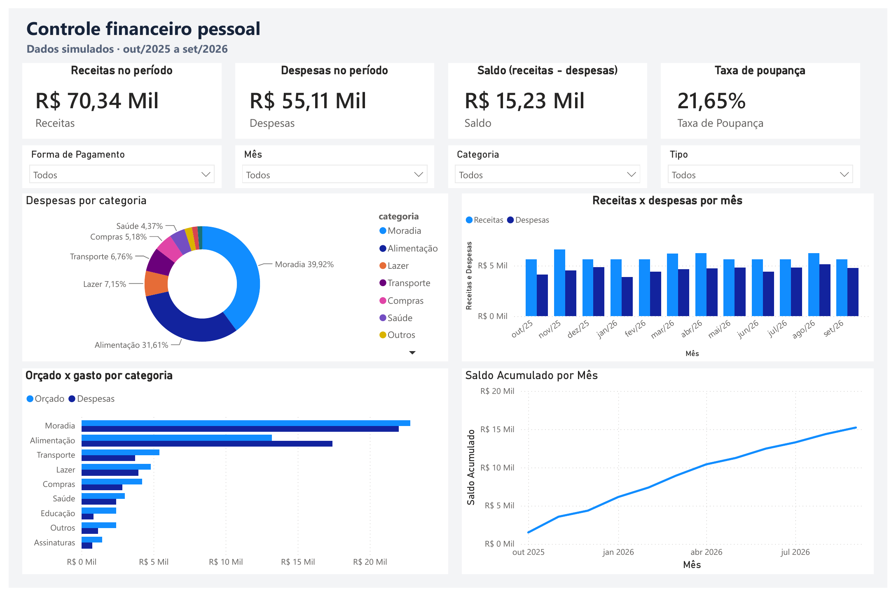
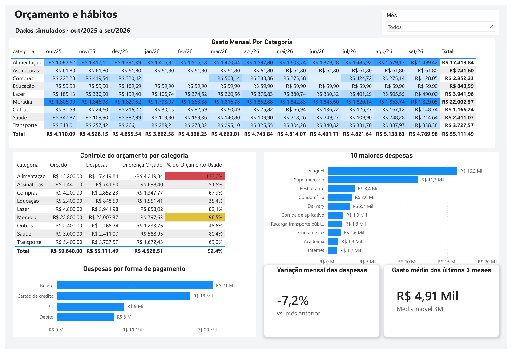
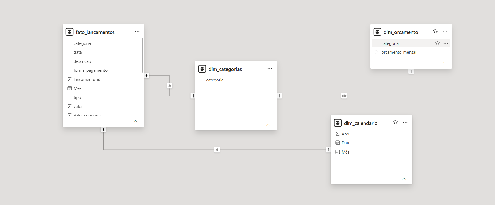

# Controle financeiro pessoal: orçamento x realizado (Excel + Power BI)

Projeto de análise de dados que responde a uma pergunta simples: **para onde vai o dinheiro e o orçamento está sendo cumprido?** Ele usa 12 meses de receitas e despesas de uma pessoa fictícia (out/2025 a set/2026) e entrega uma planilha em Excel e um dashboard em Power BI.

> **Aviso:** todos os dados são **simulados**, gerados por script Python com semente fixa. Não representam finanças reais de ninguém.

## Prévia





O relatório também está em PDF: [dashboard-financas-pessoais.pdf](dashboard-financas-pessoais.pdf).

## Perguntas que o projeto responde

1. Quanto entrou, quanto saiu e quanto sobrou no período?
2. Quanto da renda a pessoa consegue poupar?
3. Em quais categorias o gasto passa do orçamento?
4. Como as despesas mudam de mês para mês?
5. Quais são as maiores despesas e como elas são pagas?

## Principais achados (no cenário simulado)

- **Resultado do período:** R$ 70.337,55 de receitas, R$ 55.111,49 de despesas e R$ 15.226,06 de saldo, o que dá uma **taxa de poupança de 21,65%**.
- **Alimentação estourou o orçamento:** gastou R$ 17.419,84 contra R$ 13.200,00 orçados (**132%**). É a única categoria acima do limite.
- **Moradia ficou perto do teto:** 96,5% do orçamento usado (R$ 22.002,37 de R$ 22.800,00), por ser quase toda fixa (aluguel, condomínio, internet e luz).
- **No total, o orçamento foi cumprido:** 92,4% usado (R$ 55.111,49 de R$ 59.640,00), com sobra de R$ 4.528,51. O estouro de Alimentação foi compensado por categorias abaixo do limite, como Educação (35,4%) e Assinaturas (51,5%).
- **Sazonalidade:** o mês de maior gasto foi agosto de 2026 (R$ 5.138,63) e o de menor gasto foi janeiro de 2026 (R$ 3.862,58). Em setembro de 2026 as despesas ficaram 7,2% abaixo das de agosto.
- **Concentração:** Moradia (39,9%) e Alimentação (31,6%) somam mais de 70% das despesas.
- **Forma de pagamento:** boleto (cerca de R$ 21 mil) lidera, porque aluguel, condomínio e conta de luz são pagos assim. Em seguida vêm cartão de crédito (R$ 18 mil), Pix (R$ 9 mil) e débito (R$ 8 mil).

## Ferramentas

| Ferramenta | Uso |
|---|---|
| Python (`random`, `csv`, `openpyxl`) | Geração dos dados simulados e da planilha |
| Excel | Planilha com seletor de mês, orçado x realizado e gráficos (fórmulas `SUMIFS`, `COUNTIFS`, `INDEX/MATCH`) |
| Power BI (Power Query e DAX) | Tratamento, modelo em estrela e dashboard de 2 páginas |

## Modelo de dados

Modelo em estrela, com uma tabela fato e três dimensões:



| Tabela | Tipo | Descrição |
|---|---|---|
| `fato_lancamentos` | Fato | 481 lançamentos (data, descrição, categoria, tipo, valor, forma de pagamento) |
| `dim_calendario` | Dimensão | Calendário de out/2025 a set/2026, ligado pela data |
| `dim_categorias` | Dimensão | Categorias únicas, ligadas à fato e ao orçamento |
| `dim_orcamento` | Dimensão | Orçamento mensal por categoria |

## Principais medidas em DAX

```DAX
Receitas = CALCULATE(SUM(fato_lancamentos[valor]), fato_lancamentos[tipo] = "Receita")

Despesas = CALCULATE(SUM(fato_lancamentos[valor]), fato_lancamentos[tipo] = "Despesa")

Saldo = [Receitas] - [Despesas]

Taxa de Poupança = DIVIDE([Saldo], [Receitas])

Meses no Filtro = DISTINCTCOUNT(dim_calendario[Mês])

Orçado = SUM(dim_orcamento[orcamento_mensal]) * [Meses no Filtro]

% do Orçamento Usado = DIVIDE([Despesas], [Orçado])

Saldo Acumulado =
CALCULATE(
    [Saldo],
    FILTER(ALL(dim_calendario[Mês]), dim_calendario[Mês] <= MAX(dim_calendario[Mês]))
)

Variação Despesas =
VAR MesAtual = MAX(dim_calendario[Mês])
VAR MesAnt = EDATE(MesAtual, -1)
VAR DespAtual = CALCULATE([Despesas], dim_calendario[Mês] = MesAtual)
VAR DespAnt = CALCULATE([Despesas], dim_calendario[Mês] = MesAnt)
RETURN DIVIDE(DespAtual - DespAnt, DespAnt)

Média Móvel 3M Despesas =
VAR UltimoMes = MAX(dim_calendario[Mês])
RETURN
AVERAGEX(
    FILTER(
        ALL(dim_calendario[Mês]),
        dim_calendario[Mês] <= UltimoMes && dim_calendario[Mês] > EDATE(UltimoMes, -3)
    ),
    CALCULATE([Despesas])
)
```

## O que tem em cada parte

**Excel (`controle_financeiro.xlsx`)**
- **Resumo:** seletor de mês, indicadores, quadro de orçado x realizado com status (OK, Atenção ou Estourou), visão dos 12 meses e 3 gráficos.
- **Lancamentos:** base de dados em tabela.
- **Orcamento:** metas mensais por categoria, editáveis.
- **Premissas:** como os dados foram gerados e como ler a planilha.

**Power BI (`dashboard.pbix`)**
- **Visão geral:** cartões de receitas, despesas, saldo e taxa de poupança, filtros (mês, categoria, forma de pagamento e tipo), despesas por categoria, receitas x despesas por mês, orçado x gasto e saldo acumulado.
- **Orçamento e hábitos:** mapa de calor de gastos por categoria e mês, controle do orçamento com alertas de cor, 10 maiores despesas, despesas por forma de pagamento, média móvel de 3 meses e variação em relação ao mês anterior.

## Estrutura do repositório

```
projeto-financas-pessoais/
├── README.md
├── dashboard.pbix
├── dashboard-financas-pessoais.pdf
├── excel/
│   └── controle_financeiro.xlsx
├── dados/
│   ├── lancamentos.csv
│   └── orcamento.csv
├── scripts/
│   └── gerar_dados.py
└── img/
    ├── visao-geral.png
    ├── orcamento-e-habitos.png
    └── modelo-de-dados.png
```

## Como reproduzir

1. Gere os dados (opcional, os CSV já estão no repositório): `python scripts/gerar_dados.py`
2. **Excel:** abra `excel/controle_financeiro.xlsx` e escolha o mês na célula amarela da aba Resumo.
3. **Power BI:** abra `dashboard.pbix`. Se o Power BI pedir o caminho dos arquivos, aponte para a pasta `dados/`.
4. Ao carregar os CSV do zero, configure o Power BI para **Inglês (Estados Unidos)** em *Arquivo > Opções > Configurações regionais*, porque o ponto decimal dos arquivos é lido como separador de milhar na configuração brasileira.

## Aprendizados

- Modelagem em estrela e relações um para muitos no Power BI.
- Medidas em DAX com inteligência de tempo (mês anterior, média móvel e acumulado).
- Cuidado com a configuração regional na importação de CSV.
- Comunicação visual de dashboard: hierarquia, cores com significado, filtros no topo e alertas condicionais.

## Autor

**João Victor Silva dos Santos** · Estudante de Engenharia de Software · [GitHub](https://github.com/joaojvictorss)
